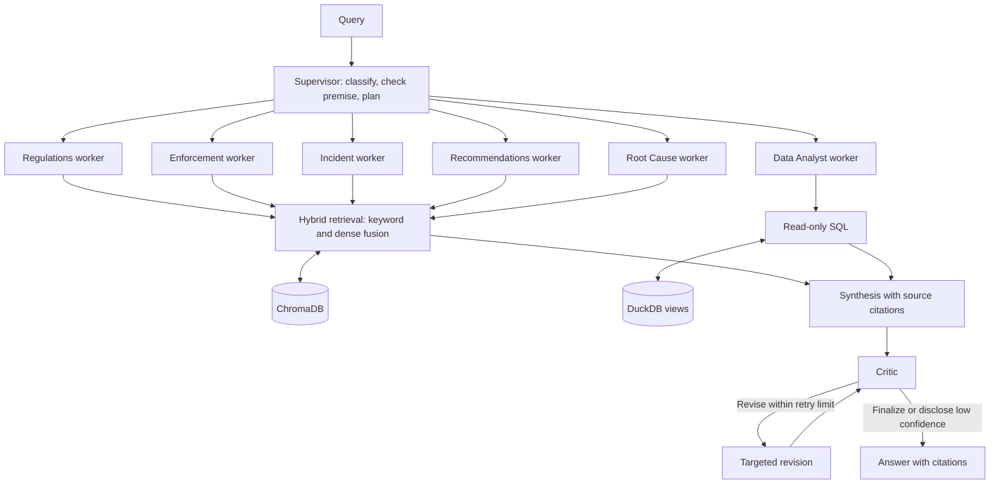
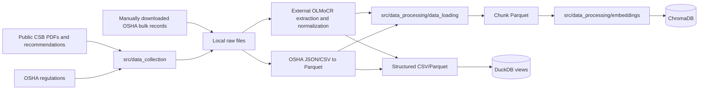
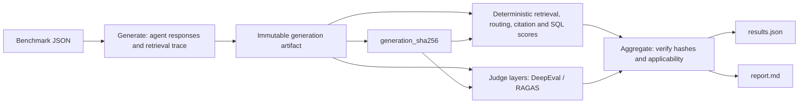

# Architecture

## 1. What this framework is

A supervisor multi-agent retrieval-augmented generation system for chemical process safety. It retrieves evidence from CSB investigations, OSHA regulations, and OSHA enforcement records, and queries structured data through DuckDB. Answers include citations and explicit evidence gaps; automated review does not establish engineering correctness.

## 2. System flow

Selected workers run in parallel. The critic reviews the synthesized draft; unsuccessful review triggers bounded revision. The retrieval implementation fuses dense results with ChromaDB keyword candidates and applies metadata filters; it does not maintain a separate persistent BM25 index.

## 3. Data pipeline and rebuilding

The [processing guide](src/data_processing/README.md#rebuild-inputs-from-public-sources) owns the collection commands, external extraction steps, input contracts, and rebuild outputs. Runtime folders under `data/`, `chromadb/`, and `logs/` are local outputs. Record source versions and extraction settings to preserve provenance.

## 4. Evaluation harness

The four processing stages use three CLI subcommands: aggregation also generates the report. Deterministic scoring is offline once a generation artifact exists. Judge layers require a configured provider. See [EVALUATION.md](EVALUATION.md) for commands, dataset overrides, and the hash contract.

## 5. Code map

| Package or module | Purpose |
|---|---|
| [src/agentic_rag](src/agentic_rag) | Core supervisor, workers, critic, retrieval tools, and graph |
| [graph.py](src/agentic_rag/graph.py) | Fan-out execution and bounded review/revision loop |
| [llm_factory.py](src/agentic_rag/llm_factory.py) | Provider-aware model construction for each role |
| [analytical_tools.py](src/agentic_rag/analytical_tools.py) | DuckDB view registration, SQL validation, and guarded execution |
| [src/data_collection](src/data_collection) | Public-source collection tools |
| [src/data_processing](src/data_processing) | Chunk validation, loading, embeddings, and indexing |
| [src/evaluation](src/evaluation) | Dataset schema, generators, scoring layers, aggregation, and reporting |
| [src/web](src/web) | FastAPI endpoints, event contract, static browser interface, and run history |
| [src/agentic_rag_web](src/agentic_rag_web) | Warm shared backend and follow-up query condensation |
| [scripts/demo_agentic_rag.py](scripts/demo_agentic_rag.py) | Shared terminal and web execution entry point |
| [tests](tests) | Mocked unit and integration tests with synthetic fixtures |

## 6. Configuration and extension points

[.env.example](.env.example) documents role/provider settings. Configure models and credentials per role, and judge settings independently. Use [configs/model_sweep.example.yaml](configs/model_sweep.example.yaml) with [run_model_sweep.py](scripts/reusable/run_model_sweep.py) for controlled comparisons; verify provider settings before live calls.

To add a worker, implement it in [workers.py](src/agentic_rag/workers.py), register it in [graph.py](src/agentic_rag/graph.py), update supervisor routing and the evaluation agent registry in [schemas.py](src/evaluation/schemas.py), and update web event labels if it is exposed there. Preserve reducer semantics for parallel state updates.

For a new corpus, provide loaders and source metadata compatible with [chunk_reader.py](src/data_processing/data_loading/chunk_reader.py), index the resulting chunks, and register retrieval tools in [tools.py](src/agentic_rag/tools.py). For structured data, register guarded DuckDB views. For a new benchmark, supply schema-valid JSON and set `EVAL_DATASET_DIR` or `EVAL_DATASET_FILE` before starting the process.

## 7. Web UI

`make web` runs `python -m src.web` with host, port and access policy from the environment and `.env`. The default address is `http://127.0.0.1:8000`. A warm graph and retrieval backend are shared across requests. Server-Sent Events stream progress and sanitized answer HTML. Follow-up condensation preserves prior uncertainty and refusals. Local history supports session inspection, export, and deletion. See the [startup instructions](README.md#quick-start-from-a-source-checkout) for token-protected network access, and [.env.example](.env.example) for server settings.
